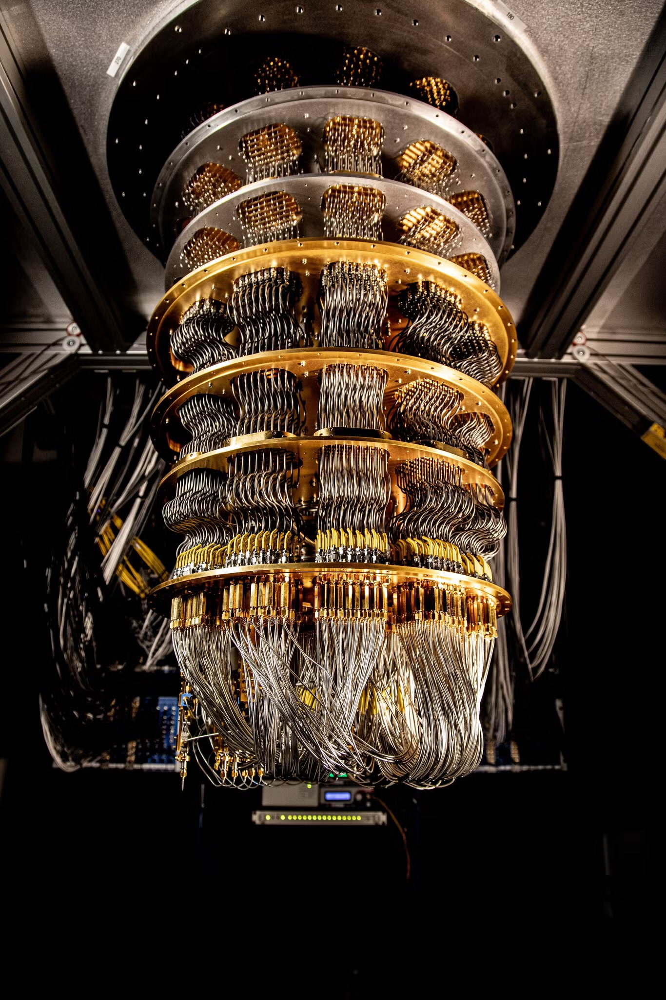

# Quantum Machine Learning

<p align="center">
  <a href="https://pennylane.ai/"></a>
  <a href="https://colab.research.google.com/"></a>
  <a href="https://scikit-learn.org/"></a>
</p>

<p align="center">
  
</p>

Simulaciones reproducibles y notebooks interactivos sobre tres arquitecturas centrales de **Quantum Machine Learning** — **QSVC**, **QNN** y **QCNN** — implementadas en [PennyLane](https://pennylane.ai/) junto con sus comparativas clásicas en `scikit-learn`.

---

## Demos interactivas

| Modelo | Notebook | Contenido | Google Colab |
| :--- | :--- | :--- | :---: |
| **QSVC** | [`qsvc.ipynb`](qsvc/notebooks/qsvc.ipynb) | *Quantum kernels*, esfera de Bloch, sesgo inductivo, *Quantum Kernel Alignment*, concentración exponencial y ruido de *shots*. | [](https://colab.research.google.com/github/Mateo-Giacometti/tp_computacion_cuantica/blob/main/qsvc/notebooks/qsvc.ipynb) |
| **QNN** | [`qnn.ipynb`](qnn/notebooks/qnn.ipynb) | *Ansatz* variacional ($R_Y, R_Z, \text{CNOT}$), estimación de $\langle Z \rangle$ con *shots*, *parameter shift*, clasificación XOR 2D y *barren plateaus*. | [](https://colab.research.google.com/github/Mateo-Giacometti/tp_computacion_cuantica/blob/main/qnn/notebooks/qnn.ipynb) |
| **QCNN** | [`qcnn.ipynb`](qcnn/notebooks/qcnn.ipynb) | QCNN $8 \to 4 \to 2 \to 1$ para reconocimiento de fases en el modelo de Ising (**QQ**), dígitos `0` vs. `1` (**CQ**) y ausencia de *barren plateaus*. | [](https://colab.research.google.com/github/Mateo-Giacometti/tp_computacion_cuantica/blob/main/qcnn/notebooks/qcnn.ipynb) |

*Nota: Cada notebook ya está ejecutado con todas sus salidas y gráficos embebidos, y puede correrse en un clic desde Google Colab (clona este repositorio e instala PennyLane automáticamente).*

---

## Organización del repositorio

Cada arquitectura sigue la misma estructura modular (`notebooks/`, `src/` y `figuras/`):

```text
.
├── assets/               # Imagen de portada
├── qsvc/                 # Quantum Support Vector Classification y quantum kernels
│   ├── notebooks/        # qsvc.ipynb
│   ├── src/              # Datasets, gráficos y animaciones
│   └── figuras/          # Figuras y GIFs generados
├── qnn/                  # Quantum Neural Networks
│   ├── notebooks/        # qnn.ipynb
│   ├── src/              # Datasets y gráficos
│   └── figuras/          # Figuras generadas
└── qcnn/                 # Quantum Convolutional Neural Networks
    ├── notebooks/        # qcnn.ipynb
    ├── src/              # Datasets (Ising y dígitos) y gráficos
    └── figuras/          # Figuras generadas
```

## Ejecución local

```bash
python3 -m venv .venv && source .venv/bin/activate
pip install "pennylane>=0.45" scikit-learn scipy matplotlib pillow jupyter
jupyter lab
```

---

## Autores

Este proyecto fue desarrollado como trabajo final para la materia **IOS465 - Computación Cuántica** en la [Universidad de San Andrés](https://www.udesa.edu.ar/), Argentina, por:

- Fausto Pettinari ([fpettinari@udesa.edu.ar](mailto:fpettinari@udesa.edu.ar))
- Ignacio Schuemer ([ischuemer@udesa.edu.ar](mailto:ischuemer@udesa.edu.ar))
- Marcos Piotto ([mpiotto@udesa.edu.ar](mailto:mpiotto@udesa.edu.ar))
- Mateo Giacometti ([mgiacometti@udesa.edu.ar](mailto:mgiacometti@udesa.edu.ar))
